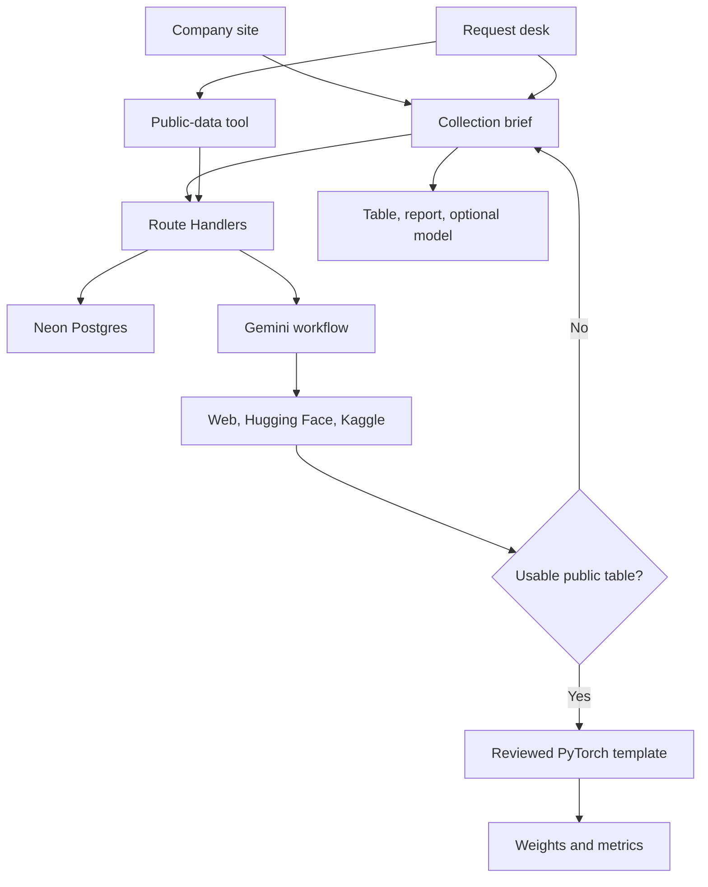

# PLAN.md — Datara

> **Company:** Original data for individuals, labs, and small and medium organizations  
> **Current phase:** Company site and desk, with Neon-backed briefs, a live public-data tool, and bounded training. No payments or live collection.  
> **Later stack:** Next.js · TypeScript · Tailwind CSS · Clerk · Neon Postgres · Gemini · Route Handlers · Python/PyTorch trainer · Docker

## 1. What Datara is

Datara collects data that does not exist yet.

A buyer describes a measurement, an experiment, or a population nobody has published. A collection team designs the work, runs it, and returns the files. The buyer can ask for three things, separately or together:

- A new dataset, delivered as a detailed table.
- Data prepared so they can train on it.
- A model, when they want Datara to train one on that data.

Buyers are individuals, small and medium labs, companies, and other organizations. A medical lab that wants average mile time from health metrics is one brief. A logistics firm, a civic group, or a single researcher can file the same kind of request. The field changes. The product does not.

Public datasets are a tool inside the product. Datara can look through Kaggle, Hugging Face, and other public sources, judge whether a table fits, combine public tables into a new set, and train a small model when the rows are enough. That tool helps when the data already exists. It is not the company. The company is hired for the data that is not on those sites.

This document’s first build is the company site and the request desk. Later sections describe the software that will store briefs and run the public-data tool. Real fieldwork, participant recruitment, devices, payments, and clinical approval stay outside the software. The prototype stores a brief and shows its status. It does not perform the collection.

## 2. Current phase

**Update.** The server layer now exists: briefs, public-data runs, training runs, and assistant messages are stored in Neon Postgres, and Gemini powers the desk assistant and the public-data workflow. The table below describes the original frontend demonstration; sign-in, saved briefs, live search and bounded training now sit behind it.

The site and the desk are a frontend demonstration.

| Surface | What it shows |
|---|---|
| Company site | Who Datara collects for, the three deliverables, worked examples, and the path into a brief |
| Request desk | Open briefs, status labels, a domain-neutral brief form, and a local queue |
| Public-data tool | Recorded links from public sources, and one recorded baseline, labeled as a tool |
| Desk assistant | Answers only from the briefs and fixtures already on the page |

Briefs and workspace settings stay in the browser. Status changes are labels. Nothing on the page searches, trains, signs a user in, or starts a collection.

## 3. Primary journey

1. The buyer names the question, the domain, what to measure, who or what is observed, and how to collect it.
2. They choose deliverables: a table, a written report, a model, or a combination.
3. The brief is saved and starts at `Pending review`.
4. A later operator view can move a demonstration brief through `Under collection` and `Fulfilled`.
5. A fulfilled brief shows the files that were promised. In the current phase those files are described, not generated.

The mile-time brief is the reference story. A lab wants average mile time estimated from health metrics. That table is not a public dataset. The request asks for a supervised collection, a CSV, a methods report, and a model. Two other fixtures keep the desk from reading as a medical product: a neighborhood heat observation, and stop-level delay on a regional delivery route.

### Brief

| Section | What it captures |
|---|---|
| Question | Title, domain, and the decision the data should support |
| Measurement | What is recorded, in what units |
| Observed | Who or what is measured, and about how many |
| Method | Experiment, observation, survey, or sensor |
| Sensor protocol | Only when the method is a sensor: rate, session length, sessions, device, synchronization |
| Deliverables | Table (`CSV`, `JSON`, or `Parquet`), report, model |
| Constraints | Geography, optional age bounds, desired date, optional budget, labeling and quality notes |
| Consultation | Whether a technical conversation is wanted. Booking is a later integration. |

The form does not ask for participant names, contact details, or uploaded health records. Age bounds are optional. When both are present, the maximum must be greater than or equal to the minimum. Sample counts are positive. A brief needs at least one deliverable.

Sensor fields are one method. An experiment, a survey, or a walked observation does not have to invent a sampling rate.

### Status labels

`Pending review`, `Under collection`, `Fulfilled`. New briefs start at `Pending review`. On the demo desk an operator can relabel a brief. The interface calls that change a label. Ordinary briefs do not imply that a field team has been assigned.

## 4. The public-data tool

This is a feature, placed behind the request.

A buyer who already has a public-data question can ask the tool to:

- Search the open web, Hugging Face, and Kaggle, and keep the real source link.
- Assess whether the columns, labels, and row counts can carry the question.
- Combine usable public tables into one new dataset.
- Train a small baseline when the result is a supported table.

If the search finds that the measurement is missing, the tool should hand the buyer a collection brief with the question already filled in. A failed search is not proof that the data is absent. A provider error stays an error. Unsupported formats stay unsupported. Only a completed look at the sources can suggest that a new collection is the next step.

Buyers may also open a collection brief directly, with no search. Many of them already know the data has never been published.

The automatic trainer, when it is built, starts with PyTorch and with CSV classification and regression. Raw video, audio, and arbitrary architectures can be described in a brief. They are not trained automatically. Section 8 holds the training sequence. It is not required to finish the current frontend.

## 5. Frontend information architecture

| Route | Role |
|---|---|
| `/` | Company page. Headline, audiences, deliverables, three examples, the collection steps, and a quiet link to the public-data tool |
| `/desk` | Request desk. Home is the open briefs |

Desk navigation, in order: Requests, Public data, Models, Collection queue, Settings. The logo returns to the company page.

The company page’s primary action opens the brief form. The secondary action opens the desk. The public-data strip links to that view of the desk.

Sample briefs on a fresh desk:

- Mile time from health metrics. Medical lab. Under collection. Table, report, and model.
- Neighborhood afternoon heat. Civic organization. Fulfilled. Table and report.
- Stop delays on a regional route. Logistics firm. Pending review.

The activity-recognition baseline remains on the Models view as a recorded fixture from a public set. Its metrics are labeled as recorded. The page does not present them as the result of a collection.

## 6. Later architecture

Keep the layers in one repository. Separate responsibilities do not require a large deployment. Build them after the frontend story is right.

| Layer | Technology | Responsibility |
|---|---|---|
| Frontend | Next.js, TypeScript, Tailwind, Clerk | Company site, buyer desk, brief form, admin queue |
| API | Next.js Route Handlers, Zod, `@neondatabase/serverless` | Sessions, ownership, Neon Postgres, progress, calendar webhooks |
| Public-data workflow | A sequential TypeScript flow started with `after()` from the run route, calling Gemini and the source APIs | Interpret a public-data question, call search adapters, assess rows, or draft a brief |
| AI | Google Gemini (`GEMINI_API_KEY`) | Desk assistant, question parsing, dataset assessment, and the training spec for a chosen table |
| Training sandbox | A fresh Docker container launched by a trusted runner | Execute a reviewed PyTorch template with fixed dependencies and resource limits |

Neon Postgres stores users, organizations, briefs, public-data runs, training runs, and assistant messages. Runs are tracked by status rows that the desk polls. Dataset files, scripts, and weights live in a local `storage/` directory and are served only through authorized routes.



**Buyer.** Creates briefs, reads their own status, downloads their own files, and may use the public-data tool. An individual has a personal workspace. Organizations have a simple profile. Team roles wait.

**Operator.** Sees every brief, adds notes, and updates demonstration states. Admin is assigned by server configuration. A user cannot choose that role.

## 7. Data models

UUIDs for application IDs. `timestamptz` for timestamps. Zod validates input and Postgres `CHECK` constraints repeat the core rules. Every table has `id`, `created_at`, and `updated_at`. JSONB holds nested fields (sensor protocol, deliverables, dataset results, metrics). Files stay on disk. Paths stay on the record. The schema is applied through the Neon MCP and lives in the `datara` Neon project.

```typescript
type ID = string;
type DateTime = Date;
interface Base { id: ID; created_at: DateTime; updated_at: DateTime }

interface User extends Base {
  clerk_user_id: string;
  email: string;
  display_name: string;
  role: 'buyer' | 'admin';
  organization_id: ID | null;
}

interface Organization extends Base {
  name: string;
  type: 'individual' | 'lab' | 'company' | 'organization';
  owner_user_id: ID;
  description: string;
}

interface Collection_Brief extends Base {
  owner_user_id: ID;
  organization_id: ID | null;
  origin: 'direct' | 'public_data_gap';
  source_run_id: ID | null;
  title: string;
  domain: string;
  question: string;
  measure: string;
  observed: string;
  sample_count: number;
  method: 'experiment' | 'observation' | 'survey' | 'sensor';
  sensor: {
    device: string;
    sampling_hz: number;
    session_minutes: number;
    sessions: number;
    synchronization: string;
  } | null;
  deliverables: {
    table: boolean;
    report: boolean;
    model: boolean;
    table_format: 'CSV' | 'JSON' | 'Parquet';
  };
  geography: string;
  age_min: number | null;
  age_max: number | null;
  desired_date: DateTime | null;
  budget_usd: number | null;
  quality_notes: string;
  consultation_requested: boolean;
  state: 'Pending_Review' | 'Under_Collection' | 'Fulfilled';
  is_demo: boolean;
  admin_notes: string;
}

interface Public_Data_Run extends Base {
  owner_user_id: ID;
  question: string;
  status: 'queued' | 'searching' | 'assessing' | 'needs_input' |
    'training' | 'completed' | 'gap_found' | 'failed';
  datasets: DatasetResult[];
  selected_dataset_url: string | null;
  gap_summary: string | null;
  brief_id: ID | null;
  training_run_id: ID | null;
  error_message: string | null;
}

interface DatasetResult {
  source: 'web' | 'hugging_face' | 'kaggle';
  title: string;
  url: string;
  description: string;
  license: string | null;
  suitability: 'viable' | 'insufficient' | 'restricted' | 'unknown';
  explanation: string;
}

interface Training_Run extends Base {
  public_run_id: ID;
  owner_user_id: ID;
  status: 'queued' | 'running' | 'completed' | 'failed';
  framework: 'pytorch';
  dataset_url: string;
  cleaning_summary: string;
  metrics: Record<string, number>;
  baseline_metrics: Record<string, number>;
  artifacts: { name: string; relative_path: string }[];
  error_message: string | null;
}
```

Clerk owns authentication. Neon does not store passwords. A buyer cannot set owner ids, roles, run results, or brief state. At least one of `deliverables.table`, `deliverables.report`, and `deliverables.model` must be true. `sensor` is required only when `method` is `sensor`.

Tables: `users`, `organizations`, `collection_briefs`, `public_data_runs`, `training_runs`, `chat_messages`. Indexes: unique `users.clerk_user_id`, owner indexes on briefs, runs, training runs, and messages, and a partial unique index on calendar booking ids when that integration exists.

## 8. Later: public-data workflow and training

Build this after briefs can be saved on the server.

1. The user enters a public-data question and, if they know them, the target and the columns they need.
2. Gemini extracts task, target, fields, and constraints. If the target is ambiguous, ask. Do not guess silently.
3. Search the Hugging Face Hub API and the official Kaggle API (a web-search adapter can be added later). Store title, source, URL, description, license, and a suitability note. Cap and deduplicate results.
4. Assess with real metadata and file inspection. Do not invent columns, row counts, or licenses.
5. If a supported CSV can carry the question, download at most 100 MB and 20,000 rows, clean from the training split only, and train from a reviewed PyTorch template inside a fresh container. Classification reports accuracy, macro-F1, and a confusion matrix. Regression reports MAE and RMSE. Always show a simple baseline.
6. If the measurement is missing, write a short gap note and offer a prefilled collection brief. The buyer can edit it before saving.
7. A source error is an error. It does not unlock a brief by itself.

Training limits for the prototype: twenty epochs, ten minutes, CPU, one job at a time. The container has no network, no secrets, a non-root user, a read-only root, and a job-specific output mount. Gemini does not write code that runs. It writes a validated spec (task type, target, feature columns, width) that the reviewed template consumes, so a model mistake cannot execute arbitrary code. The template cannot install packages or open sockets. In this prototype only Hugging Face CSV files are trained automatically; Kaggle tables are assessed and linked.

Use the Hugging Face Hub and dataset-viewer HTTP APIs and the Kaggle REST API. Credentials stay in server environment variables. Restricted sources can be shown as links. They are not bypassed.

## 9. Later API

Authenticate user routes and check ownership. Admin routes are the only cross-user reads.

| Method and route | Purpose |
|---|---|
| `GET /api/me` | Current user and role |
| `POST /api/organizations` | Create an individual, lab, company, or organization profile |
| `POST /api/briefs` | Validate and save a collection brief |
| `GET /api/briefs` | List the current user’s briefs |
| `GET /api/briefs/{id}` | Load one brief |
| `GET /api/admin/briefs` | Operator queue |
| `PATCH /api/admin/briefs/{id}` | Notes and permitted demonstration state |
| `POST /api/public-runs` | Enqueue a public-data run |
| `GET /api/public-runs/{id}` | Status, links, assessment, or gap note |
| `GET /api/training-runs/{id}` | Metrics and artifact names for an owned run |
| `POST /api/briefs/{id}/booking` | Later: consultation correlation id |
| `POST /api/webhooks/cal` | Later: verified calendar events |

A consultation embed can wait. When it exists, it is one developer calendar, a thirty-minute technical conversation, and a verified webhook. The software books a slot. It does not claim the conversation has happened.

## 10. Repository, when the backend starts

| Path | Contents |
|---|---|
| `app/` | Company site, request desk, brief form |
| `app/api/` | Route Handlers for briefs, public-data runs, training runs, chat, admin |
| `app/lib/server/` | Neon client, Clerk user sync, Gemini client, source adapters, workflow, trainer runner |
| `backend/training/` | Reviewed PyTorch template and Docker image |
| `storage/` | Ignored local files |
| `tests/` | API, brief validation, and one public-data path |
| `.env.example` | Every variable, without secrets |

The repository keeps the Next.js app at the root and the API inside it. Commit an environment example without secrets.

## 11. Build order

| Stage | Build | Done when |
|---|---|---|
| **Now — Company site and desk** | The page at `/`, the request desk, the domain-neutral brief, recorded examples, and the public-data tool labeled as a feature | A visitor can tell what Datara collects, file a brief, and find it on the desk. Public data and the recorded baseline are visibly secondary |
| **Next — Saved briefs** | Clerk, Route Handlers, Neon Postgres, ownership, operator queue | A signed-in buyer keeps a brief after refresh. Another user cannot read it. State labels stay labeled as demonstration |
| **Then — Public-data tool** | Search adapters, assessment, combine step, handoff into a brief | A public question returns real links, or a prefilled brief when the measurement is absent |
| **Then — Training** | Reviewed PyTorch template, Docker limits, metrics | One supported public CSV returns loadable weights and honest metrics |
| **Outside this plan** | Field teams, devices, recruiting, payments, compliance, production hosting | Not a software completion check |

## 12. Definition of done

**This phase.** The company page says Datara collects data that does not exist yet, for individuals, labs, and small and medium organizations, and that the work can come back as a table, a report, or a model. The desk home is a list of briefs, led by the mile-time request. The public-data tool and the recorded baseline are still reachable, and their copy calls them a tool. Filing a brief validates the form and stores it in the browser. No new backend is connected.

**Later prototype.** A buyer can sign in and file a brief that an operator can see. A second path can run a supported public-data question through search and, when the table is real, through one bounded training job. A missing measurement offers a brief. It does not pretend a field team has collected it.

Real collection remains a service Datara performs for the buyer. The software’s job is to take the brief, keep its status honest, and run the public-data tool when the rows already exist.
